<div align="center">

# Sazón Total

**La atención del restaurante, desde la comanda hasta la entrega.**

Aplicación móvil para meseros, cocina y administración, con pedidos en mesa, Delivery y asistencia con inteligencia artificial.

**Kotlin Multiplatform · Compose Multiplatform · Room · Gemini**

[Producto](#producto) · [Roles](#roles) · [Delivery](#delivery) · [Arquitectura](#arquitectura) · [Datos](#datos) · [Contexto para desarrollo](#contexto-para-desarrollo)

</div>

<table>
  <tr>
    <th align="center">Atención en mesa</th>
    <th align="center">Preparación en cocina</th>
    <th align="center">Administración</th>
  </tr>
  <tr>
    <td align="center">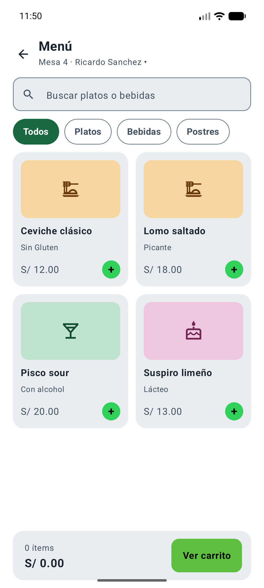</td>
    <td align="center">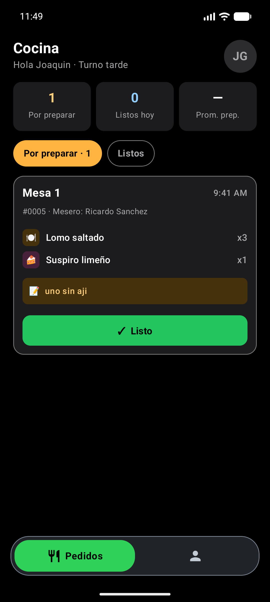</td>
    <td align="center">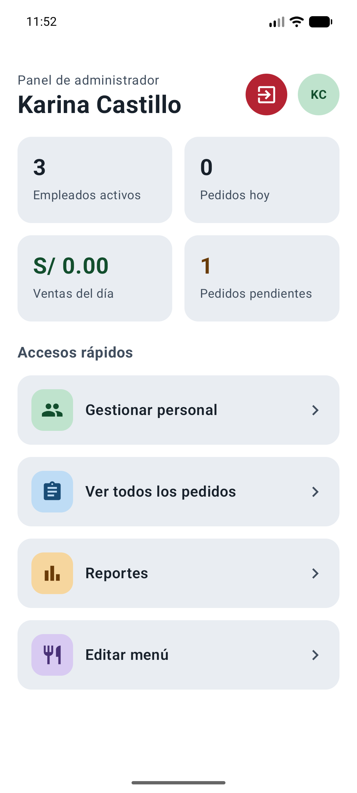</td>
  </tr>
</table>

## Producto

Sazón Total conecta las tareas de atención, preparación y gestión de un restaurante en una misma aplicación. El mesero toma la comanda, cocina recibe los platos y sus cantidades, y el administrador consulta la operación, mantiene el menú y gestiona el personal. El flujo de Delivery añade elección de dirección, ruta, tarifa y seguimiento de la entrega.

El proyecto comparte interfaz y lógica entre Android e iOS mediante Kotlin y Compose Multiplatform. La revisión visual documentada se realizó en Android. El mapa interactivo tiene implementación Android; en iOS existe un marcador visual que informa de esa disponibilidad.

Los datos operativos se guardan **localmente en Room y SQLite**. Los tres roles consultan la base de la misma instalación: no existe un backend propio ni sincronización de pedidos entre dispositivos. Gemini y los servicios de direcciones y rutas sí requieren comunicación con proveedores externos.

| Capacidad | Qué permite hacer |
|---|---|
| Atención en mesa | Elegir mesa, buscar platos, ajustar cantidades, escribir una nota general y confirmar la comanda. |
| Cocina | Revisar pedidos por preparar y listos, con cantidades y observaciones de cada comanda. |
| Delivery | Elegir una dirección, consultar distancia y tiempo, calcular la tarifa y seguir una entrega vinculada a su pedido. |
| Administración | Gestionar menú y disponibilidad, crear y activar/desactivar empleados, consultar pedidos y anularlos cuando corresponde. |
| Reportes | Consultar ventas de pedidos entregados, comparación con el período anterior y platos más vendidos. |
| Asistente IA | Consultar recomendaciones, ingredientes y maridajes con contexto del menú y una regla local para restricciones alimentarias. |
| Apariencia | Seguir automáticamente el tema claro u oscuro del dispositivo. |

## Roles

El acceso utiliza **ID de empleado y PIN de cuatro dígitos**. La cuenta debe estar activa. El prefijo del ID determina el panel inicial; el campo de rol también se utiliza para mostrar y filtrar información.

| Perfil | Prefijo | Pantallas y acciones principales |
|---|---|---|
| **Mesero** | `MSR-` | Pedidos, filtros de estado, menú, categorías, búsqueda, carrito, selección de mesa, nota general, confirmación y ticket, historial, Delivery, entregas, asistente, perfil y cambio de PIN. |
| **Cocina** | `CCN-` | Pedidos por preparar y listos, detalle de cantidades, nota general, cambio a Listo, perfil y cambio de PIN. |
| **Administrador** | `ADM-` | Indicadores, todos los pedidos, búsqueda y filtros, anulación, gestión de platos y disponibilidad, creación de empleados, activación/desactivación y reportes. |

Mesero utiliza las pestañas **Pedidos, Historial y Perfil**; cocina utiliza **Pedidos y Perfil**. El cierre de sesión limpia el carrito sin confirmar y restablece el destino de la siguiente comanda.

La gestión del personal permite **crear y activar/desactivar** cuentas. No incluye edición de empleados. La operación de desactivación protege al último administrador activo.

## Flujo de pedidos

1. El mesero elige una mesa o prepara un destino Delivery.
2. Busca productos por nombre o categoría y agrega las cantidades al carrito.
3. Revisa importes y escribe, si corresponde, una única nota general.
4. Confirma el pedido. Se guardan su cabecera y sus platos; para Delivery se guarda también la entrega vinculada en la misma transacción.
5. Se muestra el ticket y cocina recibe la comanda pendiente.
6. Cocina la marca como lista. El mesero confirma que se sirvió en mesa o que salió a reparto, según el destino.

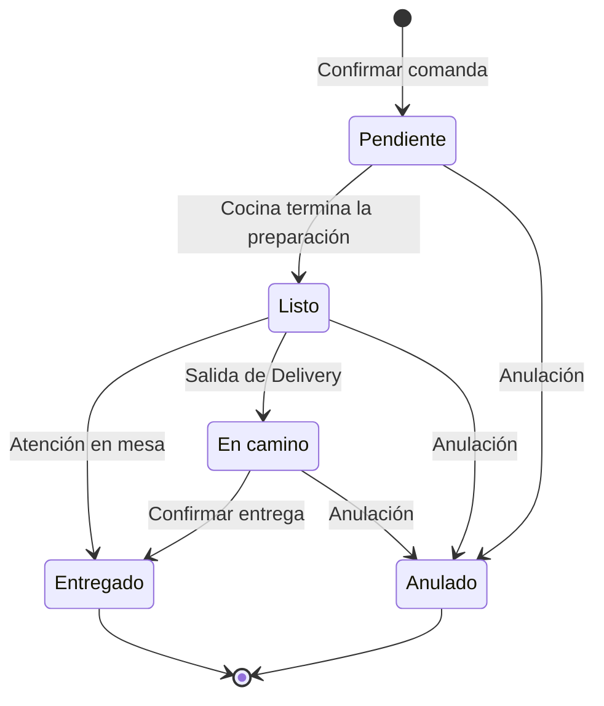

La transición a **En camino** pertenece a Delivery. Una comanda de mesa pasa de **Listo** a **Entregado**; una de Delivery debe pasar primero por **En camino**. Los pedidos anulados no pueden marcarse entregados.

Las transiciones se validan en [`TipoPedido.kt`](shared/src/commonMain/kotlin/org/sazontotal/project/data/TipoPedido.kt) y se aplican desde el repositorio con una actualización condicionada al estado anterior.

## Delivery

El módulo de reparto parte de una sede de referencia en **Av. Larco 512, Miraflores, Lima**. El mesero escribe una dirección, revisa las sugerencias y **elige explícitamente una** antes de calcular la ruta. Pulsar la lupa no selecciona automáticamente la primera coincidencia.

Después de elegir, se muestran la distancia, el tiempo estimado, el tramo cobrado y la tarifa. La ruta preparada todavía no constituye una entrega persistida: el registro se crea junto con el pedido y sus platos al confirmar la comanda.

### Tarifa por kilómetro iniciado

El costo es de **S/ 3 por cada kilómetro iniciado**, con un mínimo de **S/ 3**.

```text
kilómetros cobrados = máximo(1, techo(distancia en km))
tarifa de Delivery  = kilómetros cobrados × S/ 3
importe del pedido = subtotal de platos + tarifa de Delivery
```

| Distancia real | Tramos cobrados | Tarifa |
|---|---:|---:|
| 0,52 km | 1 | S/ 3,00 |
| 1,00 km | 1 | S/ 3,00 |
| 1,01 km | 2 | S/ 6,00 |
| 2,00 km | 2 | S/ 6,00 |
| 2,01 km | 3 | S/ 9,00 |

La distancia debe ser finita y no negativa. La regla está centralizada en [`TarifaDelivery.kt`](shared/src/commonMain/kotlin/org/sazontotal/project/data/maps/TarifaDelivery.kt).

<table>
  <tr><th align="center">Ruta en modo claro</th><th align="center">Ruta en modo oscuro</th></tr>
  <tr>
    <td align="center">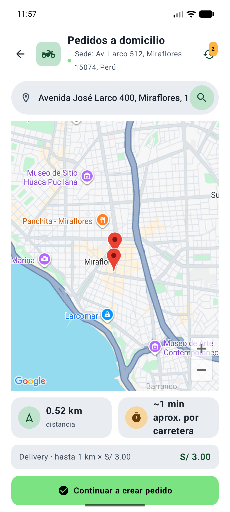</td>
    <td align="center">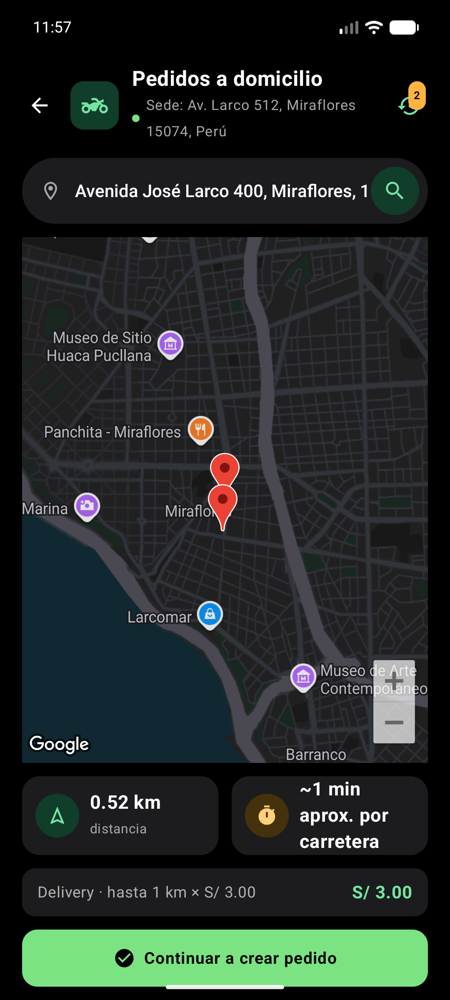</td>
  </tr>
</table>

### Vínculo entre pedido y entrega

- Cada entrega nueva de Delivery conserva un `pedidoId` identificable y único.
- El guardado conjunto es transaccional. El `solicitudId` del carrito identifica los reintentos de la misma solicitud Delivery y evita crear otro pedido para esa solicitud.
- Una entrega vinculada no se puede eliminar de forma independiente.
- El estado visible de la entrega deriva del pedido: **Preparando, En camino, Entregada o Cancelada**.
- Las canceladas no cuentan como En camino y no permiten confirmar la entrega.
- Pueden existir entregas de demostración o históricas sin `pedidoId`; se distinguen de las entregas vinculadas del flujo actual.

Para direcciones y rutas se utilizan Google Maps y respaldos implementados con Photon, geocodificación local y OSRM. Cuando se recurre a una estimación, la interfaz puede mostrar distancia o duración aproximadas. La disponibilidad de estos servicios depende de la conexión y de la configuración de sus proveedores.

## Asistente IA

El asistente está pensado para el **personal del restaurante**. Recibe contexto del menú activo, precios, categorías, descripciones, etiquetas, platos más vendidos, nombre del mesero y mesa actual.

| Tipo de consulta | Comportamiento |
|---|---|
| Recomendaciones, ingredientes o maridajes | `AsistenteIA` construye el contexto y `GeminiService` consulta Gemini mediante Ktor, incluyendo el historial actual del diálogo. |
| Consultas detectadas para evitar alérgenos o restricciones reconocidas | Una regla local preventiva revisa etiquetas explícitas antes de delegar al modelo. |
| Falta de información sobre una restricción | No se supone que un plato sea apto por ausencia de etiquetas; se indica verificar ingredientes y posibles trazas con cocina. |
| Carga o error del proveedor | La pantalla muestra el estado de espera o el mensaje de error correspondiente. |

Una etiqueta como **Sin gluten** puede aportar información sobre esa restricción; no demuestra que el plato esté libre de cualquier otro alérgeno. La regla local y la conversación normal mediante Gemini son dos comportamientos complementarios que deben conservarse.

Implementación: [`AsistenteIA.kt`](shared/src/commonMain/kotlin/org/sazontotal/project/data/ia/AsistenteIA.kt) y [`GeminiService.kt`](shared/src/commonMain/kotlin/org/sazontotal/project/data/ia/GeminiService.kt).

## Identidad visual

El tema sigue la configuración del dispositivo, sin añadir un selector propio. El diseño utiliza colores planos, superficies neutras, acciones verdes y colores funcionales para estados y contextos específicos.

| Elemento | Tema claro | Tema oscuro |
|---|---|---|
| Fondo | Blanco | Negro o gris casi negro |
| Superficies | Grises claros definidos | Grises oscuros |
| Selección principal | Verde esmeralda con texto blanco | Verde luminoso con texto negro |
| Perfil de cocina | Bloque azul con texto blanco | Bloque azul profundo con texto blanco |
| Perfil de mesero | Bloque verde con texto blanco | Bloque verde profundo con texto blanco |
| Cerrar sesión | Rojo sólido con texto blanco | Rojo sólido con texto blanco |

<table>
  <tr><th align="center">Perfil · claro</th><th align="center">Perfil · oscuro</th></tr>
  <tr>
    <td align="center">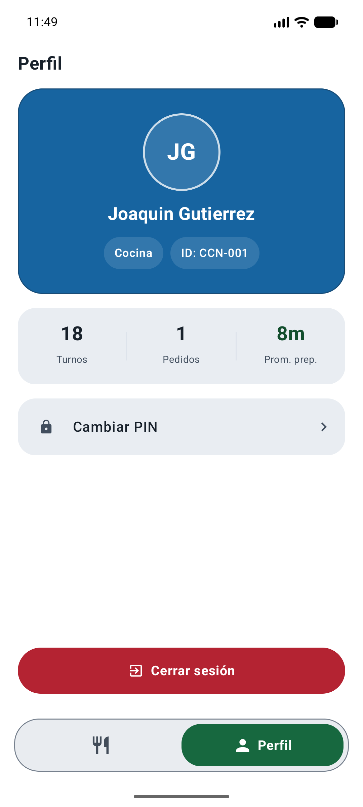</td>
    <td align="center">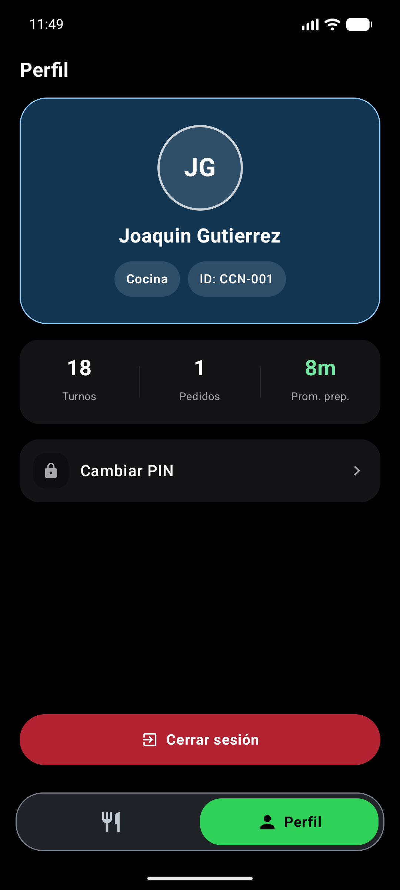</td>
  </tr>
</table>

[`SazonTheme.kt`](shared/src/commonMain/kotlin/org/sazontotal/project/theme/SazonTheme.kt) centraliza los esquemas Material, la adaptación de colores por uso y los pares de superficie, texto y acción. Los componentes compartidos mantienen la coherencia entre pantallas y roles. Android adapta también la ventana, las barras del sistema y el estilo del mapa.

## Galería

Las imágenes son capturas reales del emulador Android. Muestran datos de demostración y de las revisiones de interfaz; sus importes e indicadores no representan una cuenta de producción.

<details>
<summary><strong>Explorar menú, carrito, asistente, personal, platos y reportes</strong></summary>

<table>
  <tr><th>Pedidos</th><th>Carrito</th><th>Asistente</th></tr>
  <tr>
    <td align="center">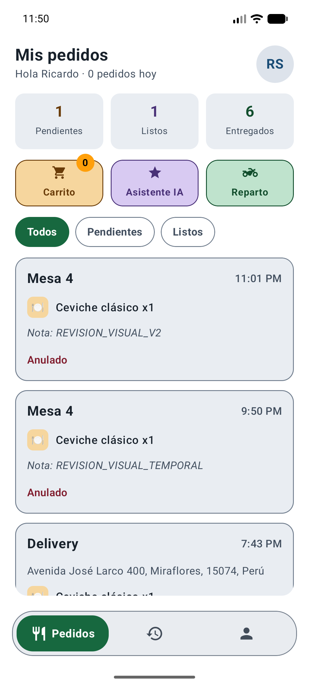</td>
    <td align="center">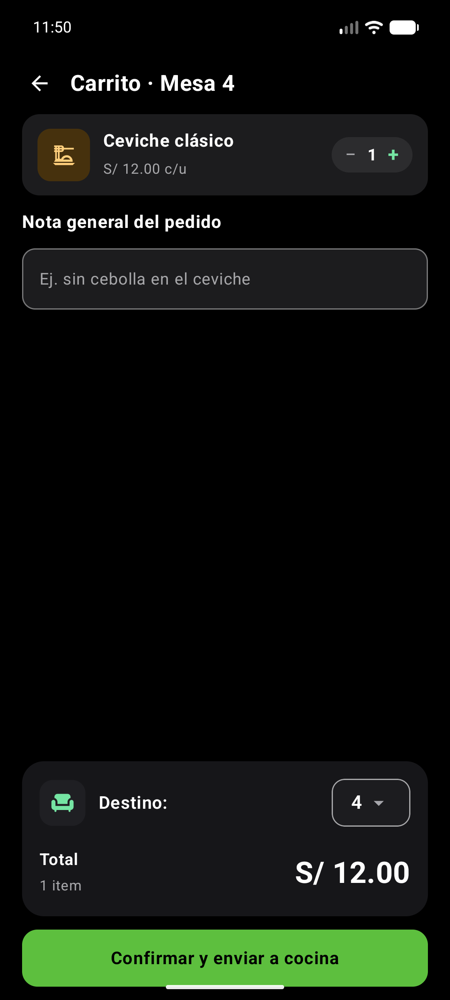</td>
    <td align="center">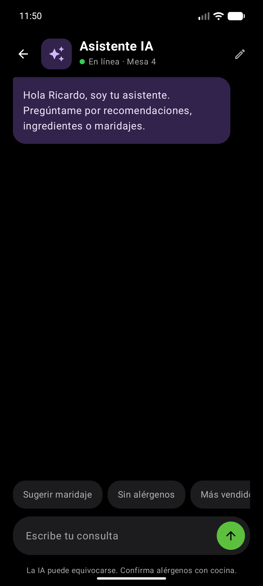</td>
  </tr>
  <tr><th>Personal</th><th>Gestión de platos</th><th>Reportes</th></tr>
  <tr>
    <td align="center">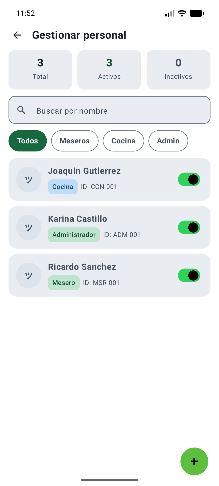</td>
    <td align="center">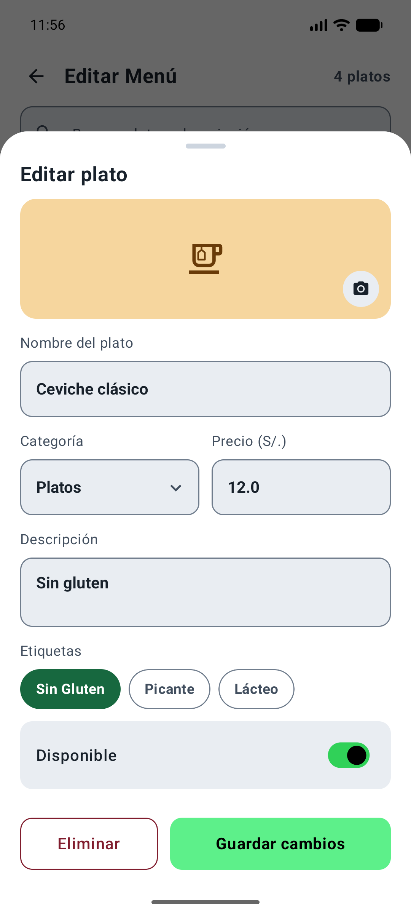</td>
    <td align="center">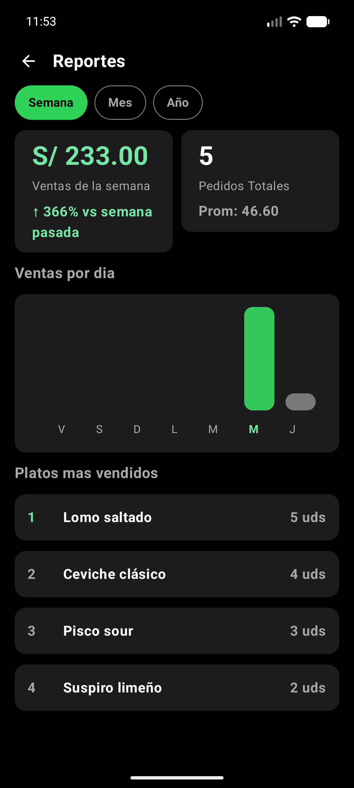</td>
  </tr>
</table>

</details>

La [galería de verificación](docs/paleta/VERIFICACION.md#capturas-reales) reúne **48 capturas**, organizadas en pares claro/oscuro, incluyendo formularios, filtros, validaciones, historial, entregas y pedidos de los tres roles.

## Arquitectura

La aplicación utiliza estado Compose y un repositorio común. `App.kt` crea y comparte la base y el repositorio, conserva la sesión y coordina la navegación. Las pantallas observan datos mediante `Flow` y mantienen su estado visual local. No hay una capa ViewModel propia separada.

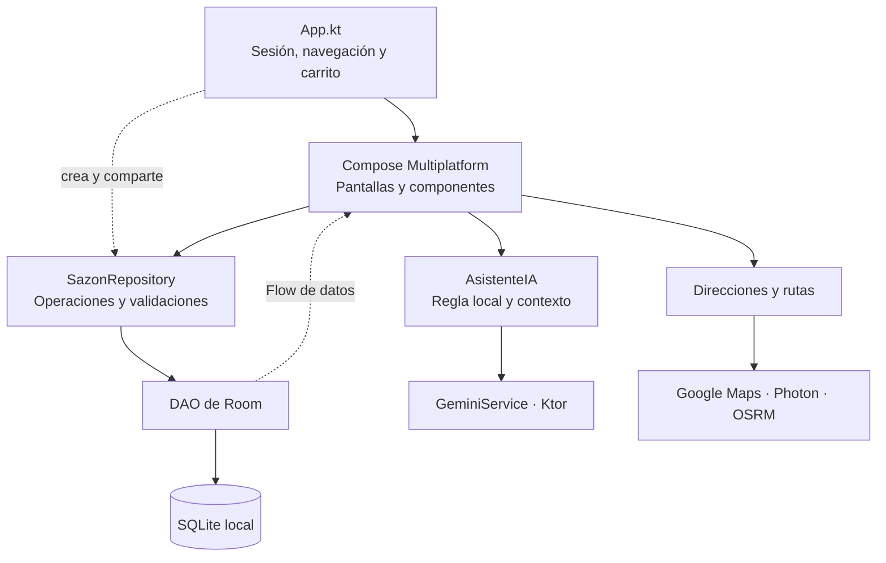

### Organización del repositorio

```text
sazonTotal-kmp/
├── androidApp/                  Aplicación y entrada Android
├── iosApp/                      Contenedor SwiftUI y proyecto Xcode
├── shared/src/
│   ├── commonMain/kotlin/       Interfaz, modelos y lógica compartida
│   ├── androidMain/kotlin/      Room, mapa y utilidades Android
│   ├── iosMain/kotlin/          Implementaciones y adaptaciones iOS
│   └── commonTest/kotlin/       Pruebas comunes
├── docs/paleta/                 Capturas e informe visual actual
└── gradle/libs.versions.toml    Catálogo de dependencias
```

Las rutas siguientes parten de `shared/src/commonMain/kotlin/org/sazontotal/project/`:

| Punto de entrada | Responsabilidad |
|---|---|
| [`App.kt`](shared/src/commonMain/kotlin/org/sazontotal/project/App.kt) | Sesión, rutas, destino, carrito compartido y conexión entre pantallas. |
| [`data/repository/SazonRepository.kt`](shared/src/commonMain/kotlin/org/sazontotal/project/data/repository/SazonRepository.kt) | Acceso a datos, validaciones, transiciones y datos iniciales. |
| [`data/db/`](shared/src/commonMain/kotlin/org/sazontotal/project/data/db/) | Cinco entidades, DAO, transacciones, migración y creación de la base. |
| [`data/CarritoCompra.kt`](shared/src/commonMain/kotlin/org/sazontotal/project/data/CarritoCompra.kt) | Cantidades, copia de productos, nota general e identidad de solicitud. |
| [`data/TipoPedido.kt`](shared/src/commonMain/kotlin/org/sazontotal/project/data/TipoPedido.kt) | Distinción mesa/Delivery y transiciones permitidas. |
| [`data/maps/`](shared/src/commonMain/kotlin/org/sazontotal/project/data/maps/) | Direcciones, rutas, entrega y tarifa. |
| [`data/ia/`](shared/src/commonMain/kotlin/org/sazontotal/project/data/ia/) | Conversación, contexto, restricciones alimentarias y cliente Gemini. |
| [`theme/`](shared/src/commonMain/kotlin/org/sazontotal/project/theme/) y [`components/`](shared/src/commonMain/kotlin/org/sazontotal/project/components/) | Sistema de colores y componentes compartidos. |
| [`screens/`](shared/src/commonMain/kotlin/org/sazontotal/project/screens/) | Login, paneles y pantallas organizadas por rol. |
| [`utils/`](shared/src/commonMain/kotlin/org/sazontotal/project/utils/) | Moneda, reloj y navegación de plataforma. |

Los puntos de entrada de plataforma son [`MainActivity.kt`](androidApp/src/main/kotlin/org/sazontotal/project/MainActivity.kt) en Android y [`MainViewController.kt`](shared/src/iosMain/kotlin/org/sazontotal/project/MainViewController.kt), hospedado en SwiftUI, en iOS. Las implementaciones específicas utilizan `expect`/`actual` cuando corresponde.

### Tecnologías

Versiones declaradas en el [catálogo del proyecto](gradle/libs.versions.toml):

| Tecnología | Versión | Uso |
|---|---|---|
| Kotlin | `2.4.10` | Código y lógica multiplataforma. |
| Compose Multiplatform | `1.11.1` | Interfaz declarativa compartida. |
| Material 3 | `1.11.0-alpha07` | Componentes y esquemas de interfaz. |
| Room | `2.7.1` | Persistencia, consultas reactivas y transacciones. |
| SQLite Bundled | `2.5.0` | Motor de base de datos. |
| Ktor | `3.2.2` | Clientes HTTP para IA y servicios de mapas. |
| Maps Compose | `7.0.0` | Mapa interactivo Android. |
| KSP | `2.3.10` | Generación de código de Room. |

Android configura SDK mínimo `24`, compile SDK `36` y target SDK `36`. El módulo compartido genera el framework estático `Shared` para `iosArm64` e `iosSimulatorArm64`.

## Datos

La base actual es **`SazonDatabase`, versión 9**, con cinco tablas. Los pedidos confirmados sobreviven al cierre de la aplicación; sesión, ruta de navegación y carrito sin confirmar viven en memoria Compose.

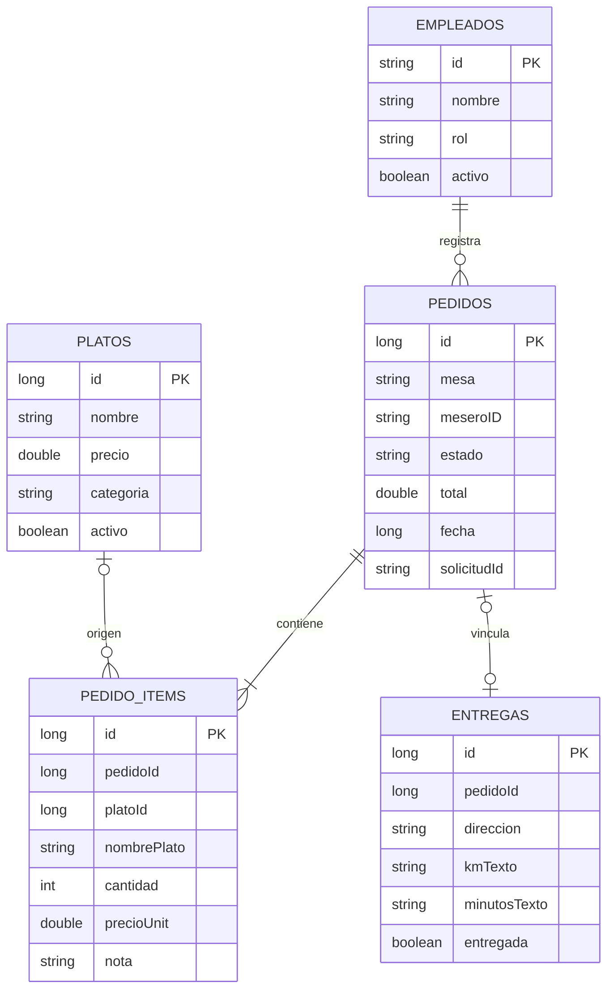

El diagrama resume **relaciones lógicas de la aplicación**, no declaraciones de claves foráneas de Room. `solicitudId` tiene un índice único en pedidos; `pedidoId` tiene un índice único y es nullable en entregas.

| Decisión | Consecuencia |
|---|---|
| Copia del nombre y precio en cada renglón | Editar o eliminar un producto del menú no reescribe los pedidos históricos. |
| Destino Delivery codificado en `mesa` como `Delivery: <dirección>` | Debe interpretarse mediante las funciones de `TipoPedido.kt`; no es un número de mesa. |
| Una nota general en el carrito | Por compatibilidad con el esquema, se guarda en el primer renglón; no hay un campo de nota general en la cabecera. |
| Total final en el pedido | El total persistido incluye el Delivery cuando corresponde. La entrega conserva distancia y tiempo como texto; no tiene una columna propia de tarifa. |
| Migración explícita de 8 a 9 | Incorpora el vínculo de entrega y la identidad de solicitud con sus índices únicos. |
| `fallbackToDestructiveMigration(true)` | Un cambio de esquema sin una migración compatible puede recrear y vaciar la base. |

### Datos de demostración

`seedIfEmpty()` agrega las cuentas de demostración que falten, sin reemplazar empleados existentes. Si el catálogo está vacío, crea Ceviche clásico, Lomo saltado, Pisco sour y Suspiro limeño. Los pedidos y las entregas de ejemplo se agregan cuando sus respectivas tablas están vacías.

Las cuentas iniciales usan los IDs `ADM-001`, `MSR-001` y `CCN-001`. Los datos sembrados permiten recorrer los tres roles y los estados de la operación. Modificar el seed no actualiza automáticamente los registros de una instalación ya existente.

## Reglas que deben conservarse

| Regla | Contrato del comportamiento actual |
|---|---|
| Precios y moneda | Los importes se presentan en soles peruanos. Los precios incluyen IGV; no se añade de nuevo. |
| Cantidades y totales | El carrito suma precio por cantidad y añade la tarifa de Delivery una sola vez cuando corresponde. |
| Disponibilidad | El repositorio valida que los platos sigan activos al confirmar el pedido. |
| Nota de comanda | Existe una sola nota general. No reintroducir notas por plato en el flujo de toma de pedidos. |
| Confirmación | El envío bloquea la interacción mientras guarda. Pedido, platos y entrega vinculada se persisten conjuntamente. |
| Reintentos Delivery | Mantener `solicitudId`, búsqueda de la solicitud existente e índices únicos; no crear otra entrega para el mismo pedido. |
| Estado de entrega | Derivar el estado del pedido vinculado y conservar la protección de las canceladas. |
| Borrado de entregas | No eliminar de forma independiente una entrega con `pedidoId`. |
| Ticket | Mantener la protección inicial de 700 ms frente a un segundo toque que active otra pantalla. |
| Personal | Exigir PIN de cuatro dígitos, cuenta activa y protección del último administrador. No hay edición de empleados. |
| Asistente | Conservar tanto las consultas normales a Gemini como la regla local preventiva de restricciones alimentarias. |
| Reportes | Contar como venta únicamente los pedidos `ENTREGADO`. Pendientes, listos, en camino y anulados no suman ventas. |

Los reportes de **Semana** usan una ventana móvil de siete días; **Mes**, una ventana de 28 días agrupada en cuatro semanas; **Año**, los doce meses del año calendario actual. La comparación usa la ventana anterior equivalente o el año anterior. El ranking se consulta para el período correspondiente.

## Estado de implementación

| Área | Alcance actual |
|---|---|
| Android | Interfaz recorrida en emulador, incluida la alternancia de temas y el mapa interactivo. |
| iOS | Contenedor SwiftUI y código compartido disponibles. Sin mapa interactivo y sin revisión de ejecución iOS en la última pasada visual. |
| Datos entre dispositivos | Persistencia local por instalación. No hay sincronización ni servidor propio. |
| Fotos de empleados y platos | Los controles de cámara son marcadores visuales; no incluyen selección ni almacenamiento de imágenes. |
| Métricas del perfil | Turnos y tiempos medios de preparación permanecen fijos. Los contadores de pedidos sí consultan los datos persistidos. |
| Empleados | Creación y activación/desactivación implementadas; edición fuera del alcance actual. |
| Gemini y rutas | Integraciones reales sujetas a conexión, configuración y disponibilidad de los proveedores. |
| Previews | `App.kt` admite un repositorio nulo si no puede inicializar la base, para permitir vistas previas. |

## Verificación

La última revisión visual documentada utilizó un emulador Android de **1080 × 2400 px** y produjo **48 capturas reales** de pantallas y estados en ambos temas. El [informe completo](docs/paleta/VERIFICACION.md) recoge las vistas abiertas, las comprobaciones, los archivos modificados y los límites de esa revisión.

| Comprobación | Resultado documentado |
|---|---|
| Compilación de la APK Android | Correcta. |
| Pruebas comunes en el host Android | 11 aprobadas: 4 de reglas comunes y 7 de colores. |
| Reglas comunes cubiertas | PIN, distinción mesa/Delivery, transiciones y tarifa por kilómetro iniciado. |
| Colores cubiertos | Pares de superficie y texto, acciones, navegación, contornos, transparencias y perfiles. |
| Revisión visual | Tres roles, filtros, formularios, validación, carrito, historial, asistente, entregas, ruta y tarifa. |
| Conservación de datos en la revisión | No se crearon pedidos ni empleados ni se guardaron formularios de gestión. |

Estas comprobaciones no constituyen una prueba integral de todos los servicios. En esa revisión no se ejecutó iOS, no se regeneró el ticket, no se volvió a comprobar una respuesta remota de Gemini ni se validó visualmente la superposición del teclado del sistema. Las pruebas de colores cubren pares concretos; no certifican la accesibilidad completa de la aplicación.

## Contexto para desarrollo

Para continuar el proyecto, el recorrido recomendado es **pantalla → repositorio → DAO → entidad**, además de `App.kt` para entender sesión, destino y navegación.

- Las rutas se coordinan con `pantallaActual` en `App.kt`; el carrito compartido se crea allí y se pasa a menú y carrito.
- Las carpetas `screensAdmin`, `screensMesero` y `screensCocina` agrupan las responsabilidades de cada rol. Algunas pantallas contienen tanto presentación como callbacks y operaciones.
- Un cambio visual debe apoyarse en `SazonTheme`, `colorDeTema`, `paletaAcento` y los componentes existentes, conservando las validaciones y las operaciones conectadas a las pantallas.
- Un cambio de pedido o Delivery requiere revisar también `TipoPedido.kt`, `TarifaDelivery.kt`, `CarritoCompra`, el repositorio y los DAO; la información debe seguir siendo consistente desde la comanda hasta la entrega.
- Los pedidos antiguos conservan sus copias de nombre, precio y notas. Las entregas históricas sin vínculo no deben confundirse con pedidos Delivery nuevos.
- Las estadísticas fijas y los controles de cámara descritos arriba son decisiones del alcance actual; no representan funciones ya implementadas.
- Los cambios de entidades, índices y versión de Room requieren considerar la migración y los datos de instalaciones existentes.

<details>
<summary><strong>Referencia breve de compilación y pruebas</strong></summary>

Desde la raíz del proyecto, Android puede compilarse y comprobarse con:

```bash
./gradlew :androidApp:assembleDebug :shared:testAndroidHostTest
```

Android Studio abre el proyecto raíz. El contenedor iOS se encuentra en `iosApp/iosApp.xcodeproj` y se abre con Xcode en macOS. Las integraciones de Gemini y mapas necesitan su configuración local de proveedor.

</details>
