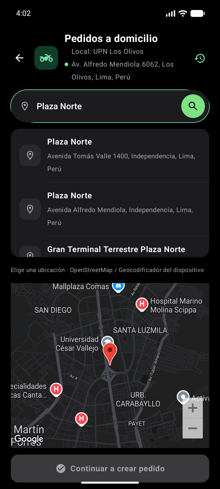
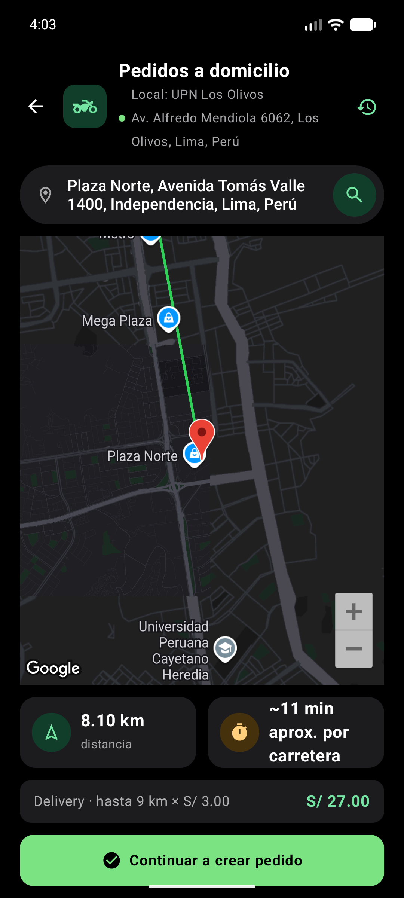
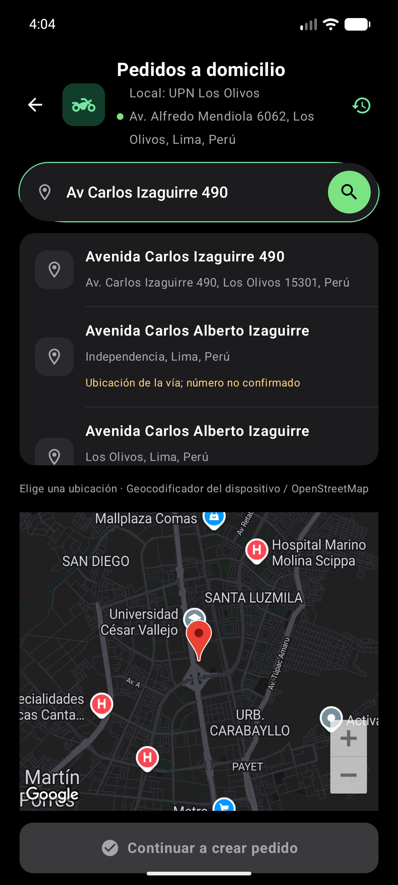
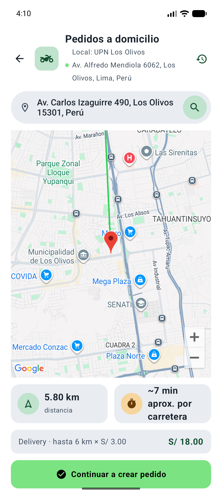
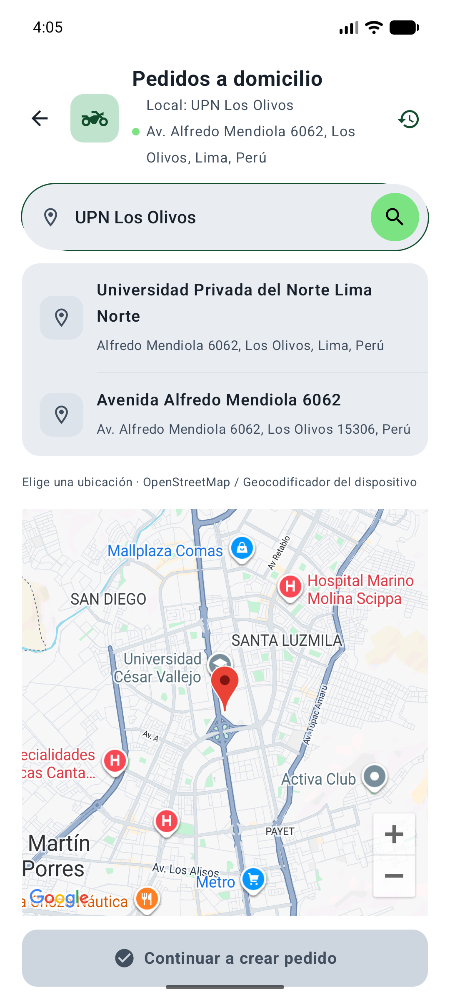
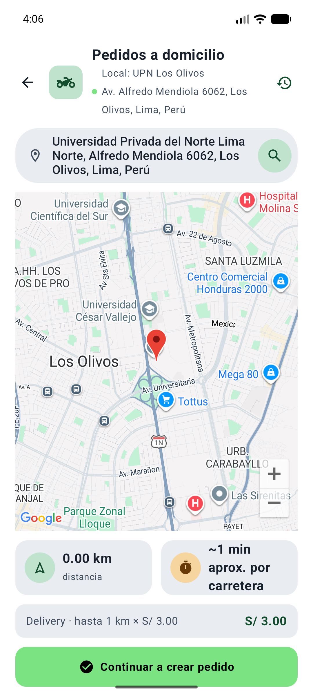

# Delivery: sede UPN Los Olivos y búsqueda de direcciones

Verificación realizada el 5 de noviembre de 2026 en Pixel 6a, Android Emulator.

## Ubicación del local

- Dirección oficial: **Av. Alfredo Mendiola 6062, Los Olivos, Lima, Perú**.
- [Fuente: Universidad Privada del Norte](https://www.upn.edu.pe/universidad-en-los-olivos).
- Punto del campus: latitud **-11.9595307**, longitud **-77.0677791**.
- [Referencia cartográfica del campus en OpenStreetMap](https://www.openstreetmap.org/way/405584319).
- El marcador del local y el cálculo de distancia comparten `SEDE_COORDENADA`. Los pedidos y las entregas anteriores conservan sus datos.

## Cambios

La búsqueda consulta concurrentemente Places Autocomplete (New), Photon/OpenStreetMap y el geocodificador de plataforma. Publica resultados conforme llegan, cancela las búsquedas anteriores cuando cambia el texto y limita el tiempo de espera de cada proveedor. Se conservan nombre, dirección, origen de la información y coordenadas o `placeId`.

La elección se realiza tocando una sugerencia. La lupa busca o permite editar la selección; nunca escoge automáticamente una coincidencia. Las coincidencias que sólo identifican una vía muestran «Ubicación de la vía; número no confirmado». Se prioriza el número solicitado cuando un proveedor lo devuelve.

## Resultados observados en Android

| Consulta | Resultado real | Selección y ruta |
| --- | --- | --- |
| `Plaza Norte` | Plaza Norte, Avenida Tomás Valle 1400, Independencia | 8,10 km; hasta 9 km cobrados; **S/ 27,00** |
| `Av Carlos Izaguirre 490` | Av. Carlos Izaguirre 490, Los Olivos 15301, Perú, devuelta por el geocodificador de Android | 5,80 km; hasta 6 km cobrados; **S/ 18,00** |
| `UPN Los Olivos` | Universidad Privada del Norte Lima Norte, Alfredo Mendiola 6062 | Coincide con el origen; 0,00 km y tarifa mínima **S/ 3,00** |

Las distancias y tiempos dependen del servicio y pueden cambiar. Los tiempos observados se identificaron en la interfaz como aproximados por carretera. El mapa mantiene su representación previa mediante una línea entre marcadores; esta intervención no añade navegación giro a giro.

Se abrió e inspeccionó el buscador y la selección de destinos en temas claro y oscuro. Se comprobó que la lupa conserva las sugerencias y que el botón para crear el pedido permanece deshabilitado antes de seleccionar. Se comprobó el desplazamiento interno de las sugerencias. La captura `10-sugerencias-scroll-claro.png` muestra el listado desplazado. No se confirmó ningún pedido ni se crearon entregas para estas pruebas.

## Capturas reales

| Búsquedas | Rutas |
| --- | --- |
|  |  |
|  |  |
|  |  |

## Compilación y pruebas

```sh
./gradlew :androidApp:assembleDebug :shared:testAndroidHostTest :shared:compileKotlinIosSimulatorArm64 --offline
```

Resultado: **BUILD SUCCESSFUL**. Diez pruebas nuevas en `BusquedaDireccionesTest`: contexto local y abreviaturas, nombre/dirección/coordenadas, número no confirmado, coordenadas inválidas, identidad de Places, prioridad y deduplicación, respuestas concurrentes, cancelación, abreviaturas sin duplicar la dirección y sede correcta.

La entrada se probó con el teclado físico del emulador. Aunque se activó temporalmente el teclado virtual en los ajustes, no se consiguió capturarlo abierto; su distribución con el teclado virtual queda sin verificación visual. Se restauró la preferencia original del dispositivo.

Android se instaló con `adb install -r`, conservando la base de datos. iOS se compiló; no se ejecutó en simulador durante esta intervención.

## Configuración y límites

La clave configurada recibió `PERMISSION_DENIED / SERVICE_DISABLED` de Places y `REQUEST_DENIED` de Geocoding en la comprobación de los servicios. No se modificaron claves ni ajustes de Google Cloud. Los resultados observados provinieron de OpenStreetMap y del geocodificador de Android.

Para utilizar el catálogo de Places directamente se debe habilitar **Places API (New)** y revisar facturación y restricciones en el proyecto de Google Cloud correspondiente. Los respaldos implementados permiten realizar búsquedas reales mientras tanto; su cobertura depende del proveedor. El respaldo nativo de iOS continúa sin implementación, igual que antes; allí se utilizan los proveedores de red comunes.

No se modificaron `App.kt`, repositorios, entidades, DAO, esquema de base de datos, persistencia conjunta del pedido, protección contra duplicados ni fórmula de tarifa. No se detectaron modificaciones concurrentes durante las comprobaciones de contenido previas a las ediciones.
